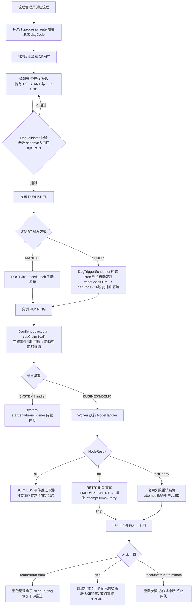

# Story: 业务编排（DAG）

## 描述
作为业务开发者，通过可视化编排定义 DAG 业务流程（节点 + 分支表达式），发布后发起实例，由分布式对等调度执行节点 handler，失败自动重试，支持人工干预治理（中断/跳过/重置/重跑/从节点重跑/终止）与开始节点时间驱动（cron 定时自动发起实例）。

## 参与者
| 角色 | 说明 |
|------|------|
| 业务开发者 | 实现 NodeHandler 并注册为 Spring Bean（默认 BUSINESS 分类），编排流程定义 |
| 流程管理员 | 创建/编辑/发布流程定义，发起实例，执行人工干预 |
| 系统 | micro-dag 引擎：调度器 CAS 领取 + 租约故障转移 + Worker 执行链路 |
| 设计器 | sh-dag-ui 图形编排（流程列表/设计器/实例列表/实例详情） |

## 流程图

## 验收标准
- [ ] 流程定义与发布：Given 节点与连线合法, When create→version/create→version/update→version/publish, Then DRAFT 草稿可编辑，发布后 PUBLISHED 不可变，保存与发布共用入口/汇点校验（恰有 1 个 START 与 1 个 END）
- [ ] 参数 schema：Given NodeHandler.paramSchema() 声明参数定义, When 保存/发布, Then 按 NodeParamDef 校验必填/范围/CRON/DATETIME/SELECT/KEY_VALUE，schema 未声明的自由键不拦截；handler/list 随定义下发供设计器渲染参数表单
- [ ] 实例发起：Given PUBLISHED 定义, When /instance/launch, Then 实例 RUNNING，入参快照进各节点 inputParams（branches/upstreams 由 launch 自动写入且实例参数不可覆盖）
- [ ] 时间驱动：Given START 节点 triggerType=TIMER 且 cron 合法, When DagTriggerScheduler 轮询到点, Then 自动 launch 实例，traceCode=TIMER-{dagCode}-v{version}-{触发时间} 幂等（同一触发点仅一个实例），Redis 锁防集群竞争，停机错过历史槽位不补触发仅补最近一个到期槽位
- [ ] 分布式调度：Given 实例 RUNNING, When 调度扫描, Then casClaim CAS 领取防重复执行；完成事件即时回调 + 轮询兜底双通道汇合于 DB CAS 天然幂等；租约过期（lease_expire_time < now）重置 PENDING 重派，attempt 耗尽置 FAILED
- [ ] 系统节点 handler：Given START/END/BRANCH/TIMER 节点, When 执行, Then 走内置系统 handler（system-start 透传入参、system-end 直接成功、system-branch 出边条件求值明细、system-timer 等待到点分片 sleep + 协作式中断 + 到点 24h 有效期），存量无 handler 定义由调度器直达成功兼容
- [ ] 分支表达式：Given BRANCH 出边 whenExpr（`${ctx.*}`/`${out.<node>.*}` + 比较 + and/or）, When 上游完成, Then 求值 false 级联 SKIPPED（仅全部入边确定性不满足时），上游未定状态（FAILED/MANUAL_STOPPED/PENDING/RUNNING/RETRYING）下游保持 PENDING 等待
- [ ] 失败重试：Given handler 返回 NodeResult.fail 或抛异常, When attempt <= maxRetry, Then RETRYING + next_retry_time（FIXED/EXPONENTIAL 退避）到期重派；output 含 String msg 键作为失败消息写 error_msg 与 output_json
- [ ] 显式失败与未就绪：Given handler 返回 NodeResult.fail/notReady, When 执行, Then FAIL/NOT_READY 事件派发，notReady 复用失败重试链路，attempt 耗尽转 FAILED
- [ ] 人工干预：Given 节点 FAILED/MANUAL_STOPPED, When interrupt/skip/reset/rerun/rerun-from/terminate, Then 中断为协作式（ctx.checkInterrupted）、skip 触发下游级联 SKIPPED 节点重置 PENDING 补救、reset/rerun 支持重设 inputParamsJson、rerun-from 从指定节点重跑后续、rerun 前 attempt>0 触发 cleanup 清理钩子，FAILED 实例恢复 RUNNING
- [ ] 过程日志：Given handler 调 ctx.log(message), When 执行中, Then 内存缓冲（上限 dag.log.max-chars 超限截断标记）按 dag.log.flush-interval-ms 落库 NODE_LOG（log_text 独立字段），节点终态 finally 兜底 flush，实例监控执行记录时间线可查看
- [ ] 跟踪编码回填：Given NodeResult.ok(...).withTraceCode, When 成功, Then trace_code 回填实例详情展示
- [ ] 引擎开关：Given dag.enabled=false, When 运行, Then 调度器/Worker/监听器不运行仅 REST 可用；dag.trigger.enabled=false 时时间驱动不运行，手动 launch 不受影响

## 关联模块
- micro-dag
- sh-dag-ui（独立前端工程，appCode=dag）

## 关联 API
- `/micro-dag/process/page`、`/micro-dag/process/create`
- `/micro-dag/process/version/create|update|publish|detail|list`
- `/micro-dag/handler/list`、`/micro-dag/expression/preview`
- `/micro-dag/instance/launch|page|detail|terminate|rerun-from`
- `/micro-dag/node/detail|interrupt|params|skip|reset|rerun`

## 优先级
P1

## 状态
已完成

## 备注
- 系统分类说明：SYSTEM 永久生效 / DEMO 受 `dag.demo-enabled` 限制（6 个演示 handler，GraalJS optional）/ BUSINESS 业务接入默认
- 全场景演示流程：`sql/dag_demo.sql`（14 条，dag_code 前缀 dag_demo_），教程见 `docs/living-docs-technical/modules/micro-dag-demo-tutorial.md`
- DDL：新建库用 `sql/dag_init.sql`；存量库升级执行 detail_json JSON 迁移 + log_text TEXT 增列
